<p align="center">
  
</p>

<h1 align="center">言葉 Kotoba</h1>

<p align="center"><b>把 JLPT 词汇，真正记进长期记忆。</b></p>

<p align="center">N5–N1 · 9 种词汇题型 · 140 个语法点 · 限时模考 · 完全离线 · 无账号 · Web + Android</p>

<p align="center">
  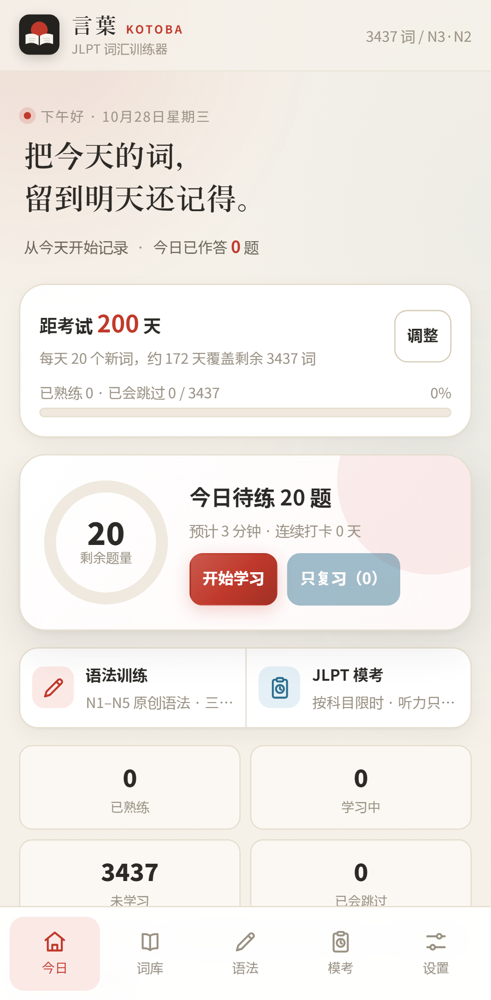
  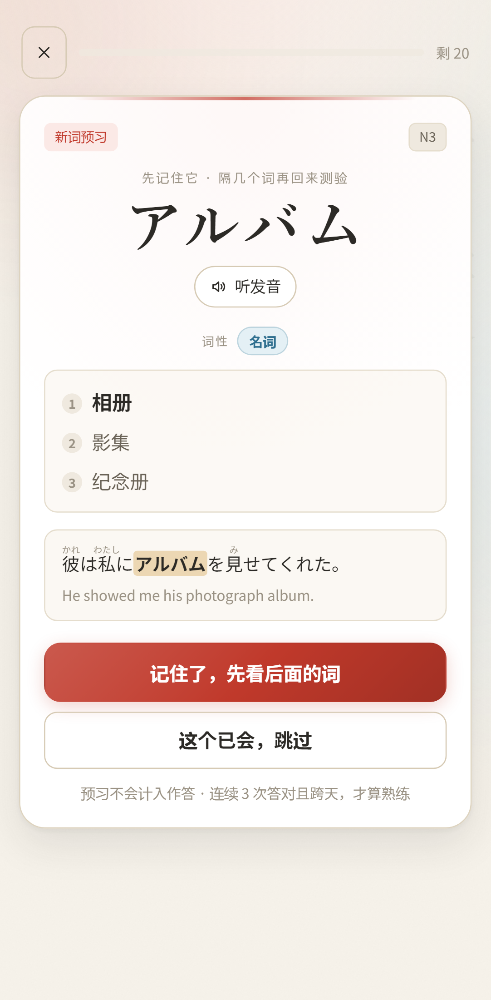
  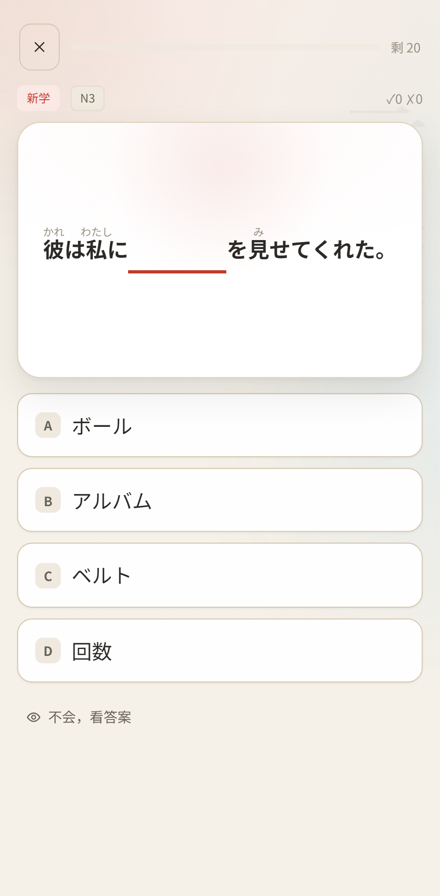
  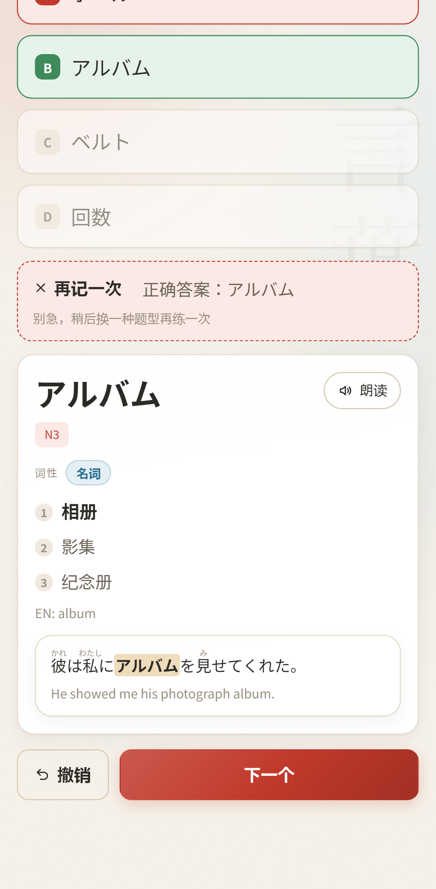
</p>
<p align="center"><sub>今日计划 · 新词预习 · 间隔测验 · 即时反馈</sub></p>

> 如果你也经历过：今天背了 50 个，第二天只剩几个眼熟；APP 显示「已掌握」，做题时却想不起来；复习列表越滚越长，最后干脆不打开——
>
> 言葉 是为这些时刻做的。它不把「看过」当成「记住」，也不靠打卡和排行榜制造焦虑。它只做一件事：让每个词在对的时间，再和你见一面。

---

## 目录

- [你可以用它做什么](#你可以用它做什么)
- [它和常见背词方式有什么不同](#它和常见背词方式有什么不同)
- [学习闭环](#学习闭环)
- [九种题型，不只四选一](#九种题型不只四选一)
- [语法训练](#语法训练)
- [JLPT 模考](#jlpt-模考)
- [词库与词义](#词库与词义)
- [把界面调成自己的样子](#把界面调成自己的样子)
- [开始使用](#开始使用)
- [数据与隐私](#数据与隐私)
- [常见问题](#常见问题)
- [参与与反馈](#参与与反馈)
- [许可与致谢](#许可与致谢)

---

## 你可以用它做什么

### 只学你真正要考的等级

N5、N4、N3、N2、N1 可以单选，也可以多选混排。选 N2 就只推 N2 的词，不会用「简单词」凑数；选 N3 + N2，就按两级的词混合出题。目标变了，随时在设置里改。

### 每天学多少，你说了算

每日新词可选 10 / 20 / 30 / 50，也可以自己填。复习有独立上限，不会被一次塞爆。

设置目标考试日期后，首页会根据剩余词量给出每日配速建议，并提前展示**未来 7 天的复习负载**。哪天要还的「记忆债」多，一眼就能看到。

### 先认识，再测验

每个新词第一次出现时，先给你一张预习卡：

- 词形、假名读音、罗马字
- 详细词性与多义项
- 带注音的例句与英文参考

点「记住了」之后，它不会立刻考你，而是**隔几个词再回来**。连续预习一组新词时，会先看完这一小组，再逐个测验，避免刚看完答案就凭短时记忆选对。

### 真正记住，才叫熟练

一个词要同时做到两件事，才会进入复习池：

1. **连续答对 3 次**（可在设置中改为 2–5 次）；
2. 这几次正确**分布在至少两个不同日期**。

当天完成的词会显示为「待明日验证」，第二天再答对一次，才真正进入复习。首页把「待明日验证」单独列出，你随时知道还差哪一步。

### 错了有人管，熟了不浪费时间

- 答错立即看到正确答案和完整词条，可以**撤销**这次作答再选一次。
- 没把握时点「不会，看答案」，系统按未掌握处理，不装作你会。
- 答错的词会换一种题型，隔几题再问一次，而不是原地重复。
- 反复答错的词会进入「易错词」，可以一键专项攻克。
- 已经会的词，在预习卡点「这个已会，跳过」即可，之后还能从词库恢复。

### 背过的词，不会悄悄消失

复习到期的词不会因为长期没复习就被自动核销。拖得越久，系统越谨慎地安排下一次复习，而不是直接判你「已掌握」。每日复习上限封顶，超出的部分顺延到之后几天，复习债不会在一夜之间滚成雪球。

### 词库是你的

- 按日文、假名、罗马字、中文释义或自己的笔记搜索。
- 按等级、词性、学习状态、收藏、易错筛选。
- 每个词都能加**个人释义**和**笔记**，搜索时也能搜到。
- 收藏、忽略、重置进度、加入今日学习，全部免费。

### 看得见的进步

统计页会显示累计作答、总正确率、连续打卡、近 14 天学习量、各等级进度、当前记忆强度分布、60 天打卡热力图，以及未来 30 天的记忆留存预测。

每个词也有自己的进度：连续正确几次、是否待验证、复习到第几阶段、下次哪天复习。

### 语法和考场，也能一起练

词汇页之外还有两个入口：**语法训练**覆盖 140 个原创语法点，三种题型轮换；**JLPT 模考**按真实科目顺序限时作答，听力只播一次，交卷后统一解析。它们与词汇 SRS 分开记录进度，不会打乱每天的词表。

### 沉浸地背，而不是刷任务

学习页会自动进入专注模式：收起导航，只留题目、选项和一层柔和的背景。没有广告弹窗，没有签到红点，也没有「再不做就晚了」的推送。

<p align="center">
  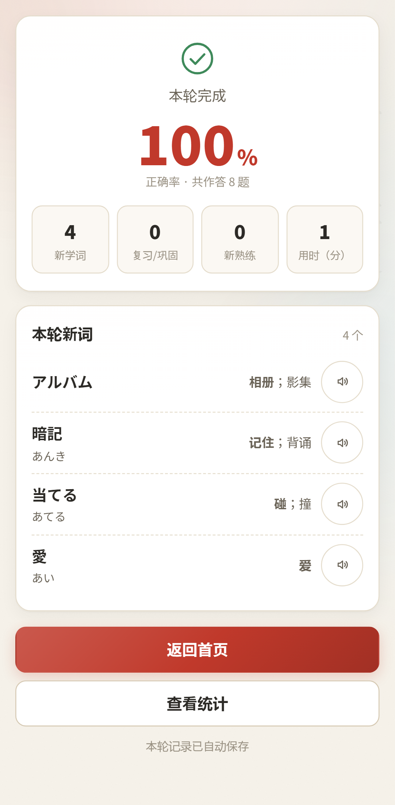
  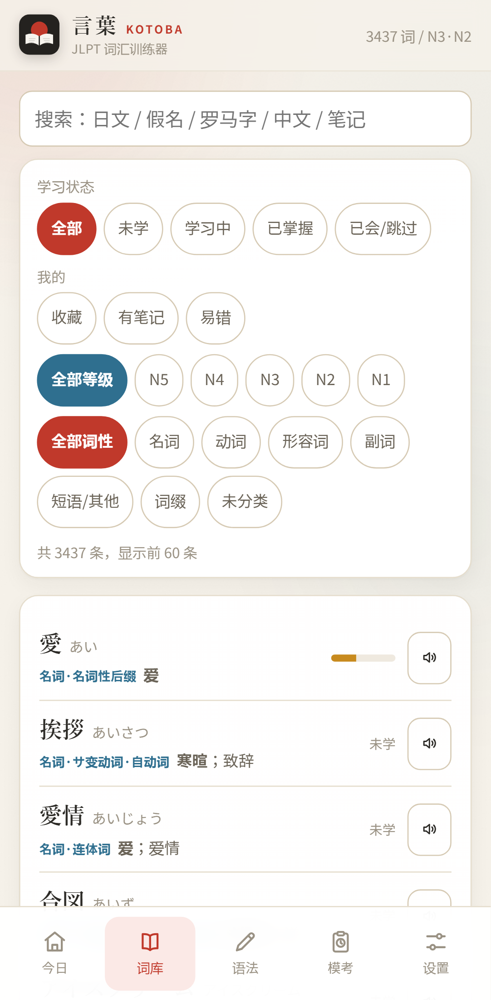
  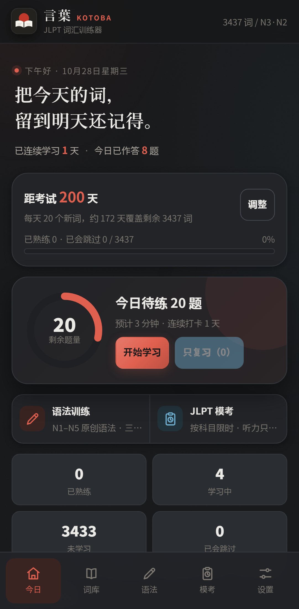
</p>
<p align="center"><sub>学习总结 · 可搜索词库 · 深色主题</sub></p>

---

## 它和常见背词方式有什么不同

| 常见体验 | 言葉的做法 |
|---|---|
| 新词看一眼就出选择题，靠短时记忆选对 | 先预习，隔几个词再考；连续 3 次答对且跨天验证，才进入复习 |
| 「已掌握」看不懂怎么来的 | 每个词显示连击、待验证、复习阶段与下次复习日期；首页单列「待明日验证」 |
| 每天的新词与复习越堆越多 | 自己设每日新词和复习上限；提前展示未来 7 天负载；逾期只顺延，不静默核销 |
| 只有四选一，能靠位置和排除法猜 | 9 种题型覆盖看、听、选、写、评；答错后换题型再练 |
| 熟词也要从头背，浪费时间 | 预习卡可一键「已会，跳过」；词库可随时恢复 |
| 笔记、收藏、个人释义要开会员 | 全部免费；自己的笔记和释义也能被搜索 |
| 注册账号、上传数据、被广告打断 | 完全离线，无账号，无广告，记录只留在自己的设备 |
| 手机、平板、电脑各一套割裂的体验 | 同一套设计适配手机、平板与桌面；学习时统一进入专注模式 |
| 背词 App 只管单词，语法和套题还要另找 | 同一个应用里提供语法训练与限时模考；进度分开记录，不互相干扰 |

---

## 学习闭环

```text
选择等级 + 每日新词量
          │
          ▼
    新词预习卡
  （词形 / 读音 / 词性 / 多义项 / 例句）
          │
          ▼   隔几个词再出现
      九种题型轮换测验
          │
          ▼   连续 3 次答对
       跨天验证
          │
          ▼
     进入复习池
          │
          ▼
  1 天 → 2 天 → 4 天 → 7 天 → 更久
          │
          └── 答错：缩短间隔，换题型重练
```

预习不计入作答；「跳过」只表示已会，也不会被算成熟练。熟练的判断标准始终是「连续答对 + 跨天验证」。

---

## 九种题型，不只四选一

| 题型 | 练什么 |
|---|---|
| 看日文选中文 | 词形 → 词义，最基础的认词 |
| 看中文选日文 | 词义 → 词形，反向回忆 |
| 看日文选读音 | 词形 → 假名，避免「会看不会读」 |
| 看假名选日文 | 读音 → 词形，强化形音对应 |
| 听音选日文 | 听 → 词形，训练耳朵 |
| 听音选中文 | 听 → 词义，听力与理解同时练 |
| 听写 / 拼写 | 听或看释义 → 写出单词，接受平假名、片假名与罗马字 |
| 例句填空 | 在真实语境里选词，带注音与中文提示 |
| 卡片自评 | 快速过词，适合复习已经很熟的词 |

默认开启 6 种，其余可在设置里自由勾选。新词先建立「形—义」和听音识别，学习中练「义—形」和读音回忆，熟练后才加入拼写等产出型题型。

如果设备没有可用的日语语音，听力题会自动隐藏并提示，不会出现「让你听但完全没有声音」的死题。

---

## 语法训练

词汇之外，JLPT 的言语知识还考语法。应用内置 **140 个原创语法点**（N5 30 / N4 30 / N3 30 / N2 25 / N1 25），每个点都给出接续、中文释义、带翻译的例句和一句说明。

练习在三种题型之间轮换：

| 题型 | 练什么 |
|---|---|
| 形式选释义 | 看到「〜なければなりません」，选出「必须……」 |
| 释义选形式 | 看到中文释义，回忆对应的日语形式 |
| 例句填空 | 把语法点放回句子，判断接续是否正确 |

干扰项来自同等级其他语法点，不会拿超纲形式凑数。连续答对 2 次即算掌握；答错会清零连击，但不会抹掉已经掌握过的记录。语法页支持按等级、掌握状态和关键词筛选，点开任一点可以看接续与例句，也可以随时「练一组」。

> 语法点与例句均为项目原创，不包含官方真题或教材原文。

<p align="center">
  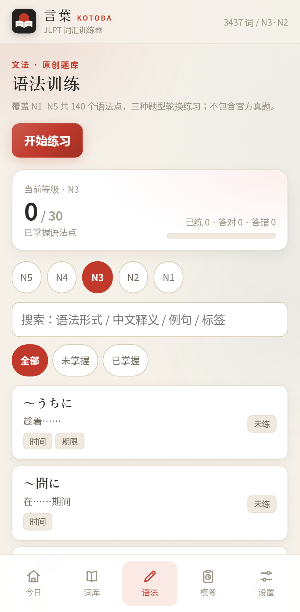
  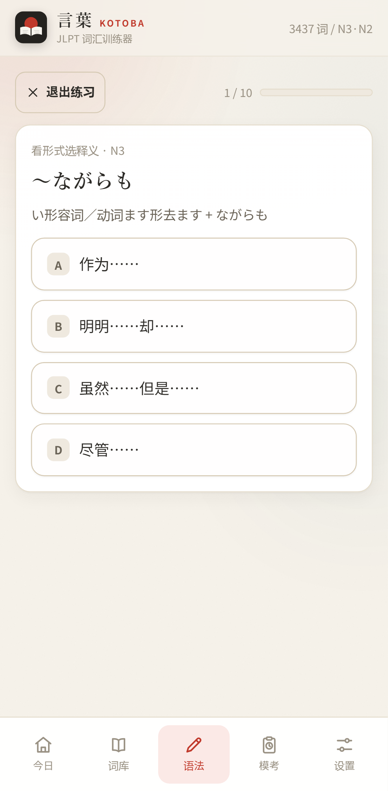
  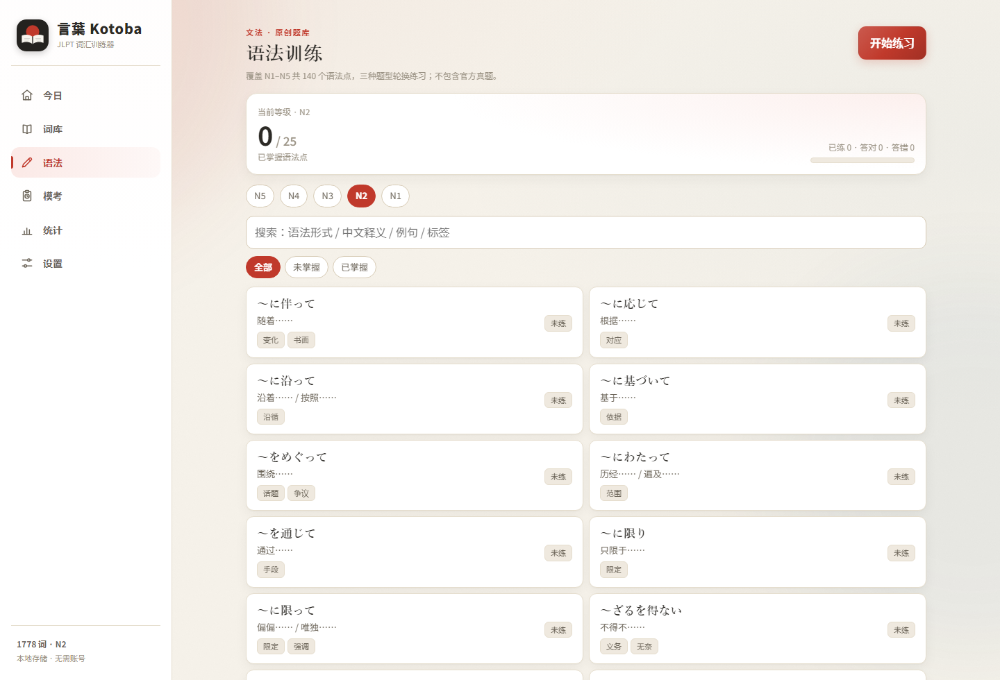
</p>
<p align="center"><sub>按等级与掌握状态筛选 · 三种题型轮换 · 桌面端双列浏览</sub></p>

---

## JLPT 模考

模考页是一间「小型考场」：选等级后生成一份原创试卷，按真实科目顺序限时作答。

- **科目结构与合格线对照 JLPT**：N1–N3 分为言语知识 / 阅读 / 听力，单科最低 19 分；N4–N5 的言语知识 + 阅读合并为 120 分，单科最低 38 分，听力最低 19 分。合格线分别为 100 / 90 / 95 / 90 / 80。
- **每部分单独倒计时**：时间到自动提交；提交后立即锁定，不能返回修改。
- **听力只播一次**：由设备 TTS 现场合成，播放后不能重听；没有日语语音时自动切换为文字模式，仍按原题量计分。
- **交卷后统一解析**：总分、单科分、合格判定与逐题解析一起公布；阅读可展开原文，听力可展开脚本。
- **历史成绩留在本机**：模考次数、合格次数、最高分和每次单科分数都能回看。

题库体量小于真实试卷，因此时长按题量等比压缩（界面会标注），但科目顺序、单科最低分与合格线保持一致。

> 本应用**不包含历年真题与官方听力音频**。所有题目和听力脚本均为原创，仅用于自测；官方样题请访问 [jlpt.jp 官方样题](https://www.jlpt.jp/e/samples/)。

<p align="center">
  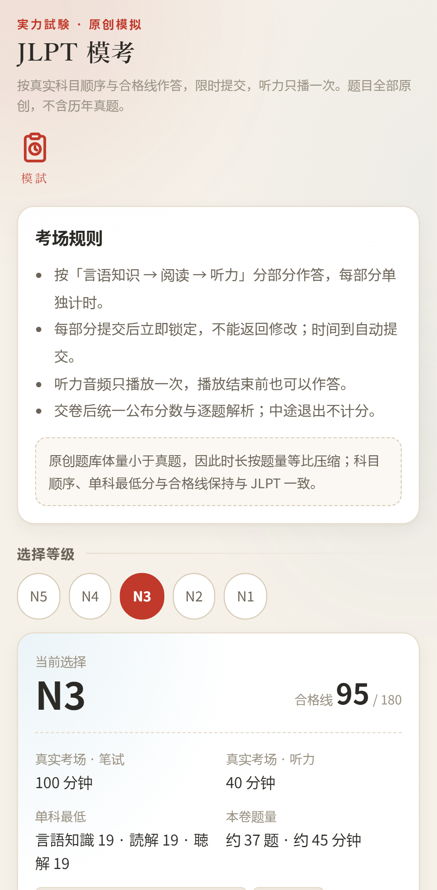
  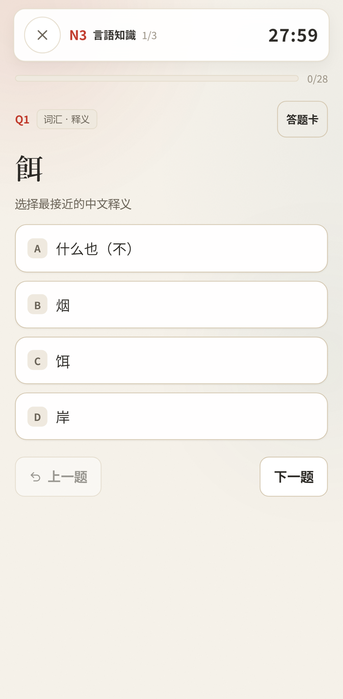
  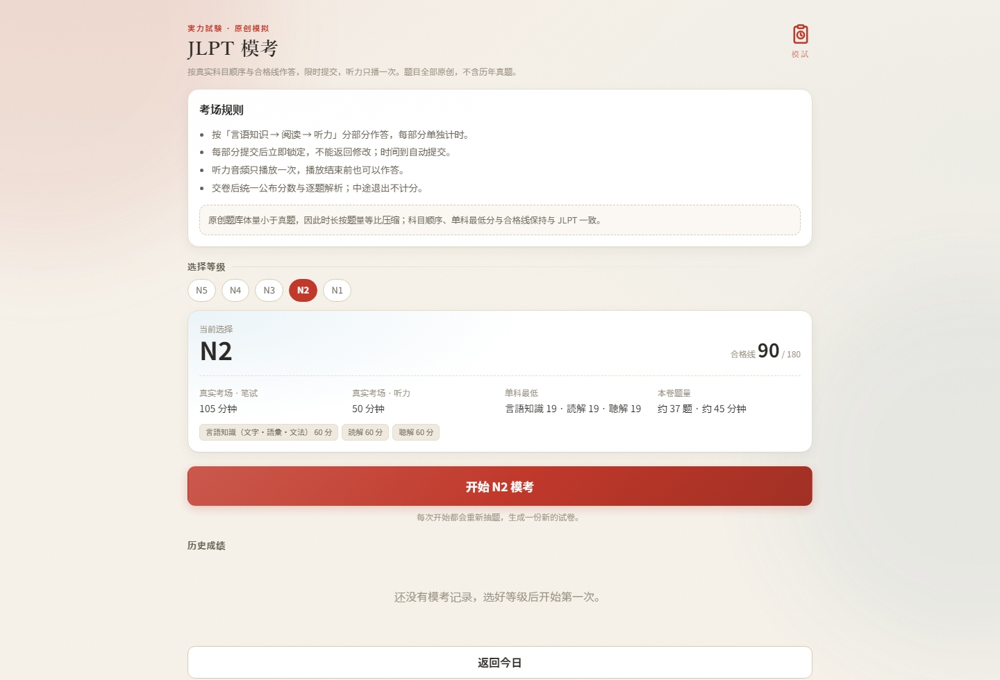
</p>
<p align="center"><sub>按等级查看结构与合格线 · 分部分倒计时 · 桌面端模考大堂</sub></p>

---

## 词库与词义

| 等级 | 词数 |
|---|---:|
| N5 | 674 |
| N4 | 630 |
| N3 | 1,659 |
| N2 | 1,778 |
| N1 | 3,070 |
| **合计** | **7,811** |

- **中文释义覆盖 100%**，例句覆盖 92.8%。
- 每个词条都标注详细词性：名词、五段动词、一段动词、他动词、自动词、形容词、副词、连体词、接续词等。
- 多义词尽量完整列出，按常用程度排序，最多 6 条；**第一条常见释义加粗**。
- 例句带假名注音，并在句中高亮目标词；部分例句附英文参考。
- 支持添加个人释义，覆盖不理想的词条可以按自己的理解修正。

词库依据公开的 JLPT 词表与开源日中词典整理，不含禁止商用或限制再分发的数据。具体来源与许可见文末。

---

## 把界面调成自己的样子

- **四色强调色**：朱、靛、松、梅，按钮、进度条与印章会一起换色。
- **和纸纹理**：细微纸纹与角落柔光，减少纯色屏幕的单调。
- **沉浸学习背景**：只保留题目与柔和底色，进入专注状态。
- **学习页大字**：放大题干与选项，适合小屏或长时间阅读。
- **深浅主题**：白天与夜间都舒服。
- **学习节奏**：每日新词数、复习上限、新词顺序、考试日期、答题重练延迟。
- **题型偏好**：自由开关 9 种题型，调整选项数量与干扰项强度。
- **手机 / 平板 / 桌面**：手机底部导航 + 单列，平板居中收窄，桌面左侧栏 + 双列信息区。

这些外观选项只影响本机显示，并会随备份一起导出。

<p align="center">
  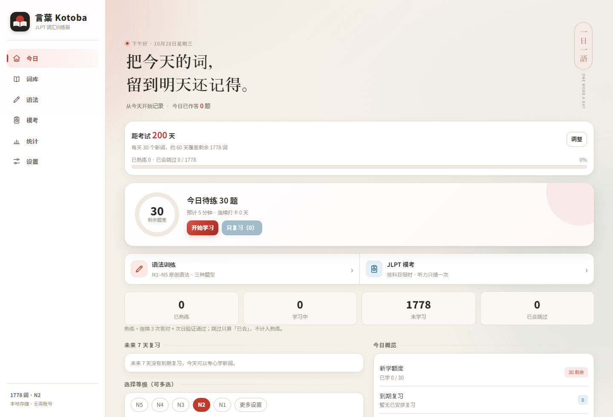
</p>
<p align="center"><sub>桌面端：侧栏导航 + 双列信息布局</sub></p>

---

## 开始使用

### 网页版

言葉 是一个可安装的网页应用（PWA）。将项目部署到你自己的静态空间后，用浏览器打开，选择「安装应用」或「添加到主屏幕」即可。首次打开有三步引导：选等级、定每日词量、设目标考试日期。

### Android

项目包含完整的 Android 工程，界面、词库与学习记录与网页版一致。项目暂未上架应用商店。

- [下载 Android APK v1.0.0](https://github.com/SeupLio/kotoba-jlpt/releases/latest/download/kotoba-1.0.0.apk)（约 4.4 MB）
- [查看版本说明](https://github.com/SeupLio/kotoba-jlpt/releases/tag/v1.0.0)
- 也可以按 [开发与交接说明](docs/HANDOVER.md) 自行构建

> v1.0.0 APK 尚未包含本轮新增的语法训练与模考；最新 Web 代码已同步进 debug 包，正式 release 将在下个版本发布。

### 第一次打开

1. 选择要学的等级（可多选）。
2. 选择每天的新词量；不确定就选 20。
3. 有考试日期就填上；没有也可以直接开始。

之后所有设置都能在「设置」里修改。

---

## 数据与隐私

- **不注册、不登录、不上传。** 没有账号系统，没有第三方统计，没有广告。
- 学习记录、笔记、收藏与设置都保存在当前浏览器或设备本地。
- **清理浏览器数据、卸载应用会丢失记录。** 建议定期在设置里导出备份。
- 换设备时，用「导出备份 / 导入备份」迁移，不需要云端。
- 发音由系统语音合成提供；Android 需要在系统中安装日语语音包，网页版推荐使用 Chrome 或 Edge。缺少语音时，词汇练习的听力题会自动隐藏，模考听力则切换为文字模式。

---

## 常见问题

**为什么「已熟练」一直是 0？**

熟练需要连续答对 3 次，并且正确记录跨至少两个日期。当天完成的词会先显示为「待明日验证」，第二天再来答对一次，才会进入复习池。首页的「今日概览」里能看到有几个词在等待验证。

**今天不想学新词，只想复习？**

可以。把每日新词数设为 0，或在首页点「只复习」。复习上限也可以在设置里调整。

**复习会不会越滚越多？**

每日复习有上限，首页会提前展示未来 7 天的复习负载。超过上限的部分顺延，不会被静默删除，也不会自动判为已掌握。如果真的积压，建议先把每日新词调低，先还复习。

**为什么有的词没有例句？**

词库例句覆盖率为 92.8%，没有例句的词不会进入例句填空题型，其他题型不受影响。

**听力题没有声音？**

网页版推荐 Chrome / Edge；Android 请在系统设置里安装日语 TTS 语音数据。系统没有日语语音时，词汇练习会自动隐藏听力题并给出提示；模考的听力部分会切换为文字模式，按原题量计分，并明确说明当前是文字模式。

**模考用的是历年真题吗？**

不是。模考题目、阅读文章和听力脚本全部为项目原创，不包含官方真题或音频。科目顺序、单科最低分与合格线参考 JLPT 公开说明，分数仅用于自测参考；官方样题可在模考首页跳转到 jlpt.jp。

**能自己添加单词或导入词库吗？**

当前词库以 JLPT N5–N1 词表为准，不支持导入自定义词库。但每个词都可以添加个人释义和笔记，支持搜索，也能用来补充专业术语或自己的记忆点。

**有云同步、排行榜或社交功能吗？**

没有，这是刻意的。目标是做一个安静、离线、只属于自己的背词工具；跨设备请用备份文件。

**Android 版在真机上稳定吗？**

已在 Android 14（API 34）模拟器上走通新手引导、预习、多种题型、撤销、退出结算、词库搜索、统计、深色主题、软键盘、返回键、横竖屏与断网启动。不同厂商的 TTS、输入法与手势条可能存在差异，建议在自己的设备上再确认。发音音色与音调取决于系统语音包，本应用不含音调标注。语法训练与模考为新增功能，已在桌面浏览器完成全流程实测，debug APK 已包含新题库，Android 真机仍待抽测。

---

## 参与与反馈

这是一个个人学习项目，但非常欢迎一起把它做得更好：

- 发现释义不准确、词性标注错误、例句缺失，欢迎提 Issue 或 PR。
- 有新的练习方式、统计维度或无障碍建议，也欢迎讨论。
- 提交词库数据前，请确认许可允许再分发；不要提交来源不明或限制商用/再分发的数据。

开发、构建与设计说明：

- [开发与交接](docs/HANDOVER.md)
- [产品与交互设计](docs/DESIGN.md)
- [全部界面截图](docs/screenshots/)

---

## 许可与致谢

- **代码**：[MIT](LICENSE)。
- **词库数据**：衍生自 [OpenJLPT](https://github.com/evancloutier/openjlpt)（CC BY-SA 4.0）与 [Japanese-Chinese-thesaurus](https://github.com/lxl66566/Japanese-Chinese-thesaurus)（Unlicense），因此 `data/processed/` 下的数据按 **CC BY-SA 4.0** 分发，使用时请保留来源标注。项目人工补录的释义以 CC0 提供。
- **原创题库**：`data/content/` 下的语法点、阅读文章与听力脚本均为项目原创，不含官方真题或音频，按 **CC BY-SA 4.0** 提供。
- **图标与界面**：为本项目原创设计，未使用第三方 UI 资产。

感谢 OpenJLPT 与 Japanese-Chinese-thesaurus 的作者公开数据，让一个个人项目也能站在可靠的数据基础上。

---

<p align="center"><sub>言葉を覚えるのは、繰り返すことから。</sub></p>
